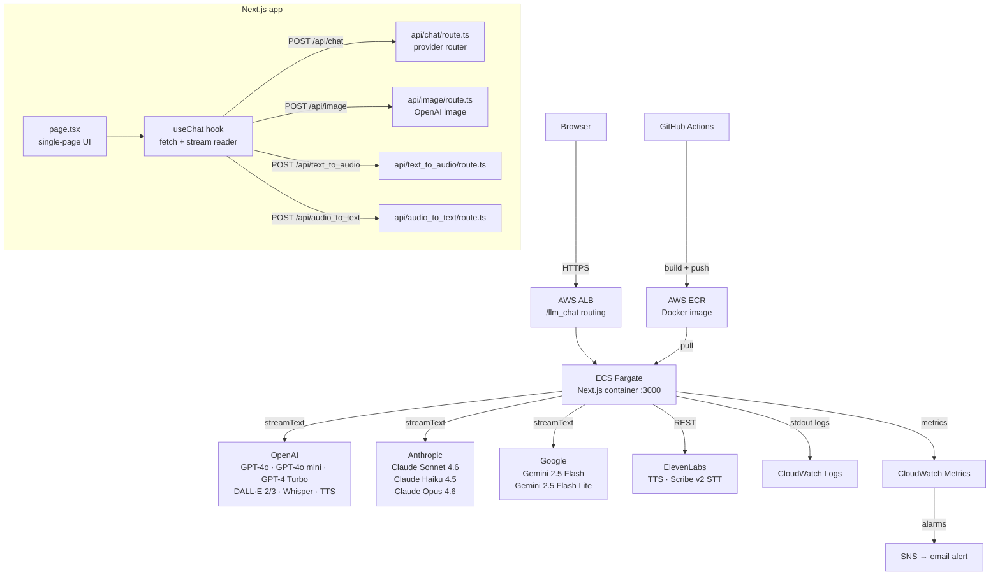

# LLM API — Multi-Provider AI Chat, Image & Audio

A production-ready Next.js 16 + React 19 web app that unifies **chat, image generation, and audio (TTS/STT)** across four AI providers behind a single UI. Built as a portfolio project demonstrating AI backend engineering: provider abstraction, streaming, Docker, CI/CD, and AWS deployment.

**Live:** `https://www.diegoportillo.dev/llm_chat` *(deployment in progress — see [AWS](#aws-deployment))*

---

## What It Does

| Mode | What you can do |
|---|---|
| 💬 **Chat** | Streaming text conversation with OpenAI, Anthropic, or Google models |
| 🎨 **Image** | Generate images (DALL·E 2/3, GPT-image) or upload one for vision analysis |
| 🔊 **Audio** | Text-to-speech with OpenAI TTS or ElevenLabs; speech-to-text with Whisper or ElevenLabs Scribe v2 |

---

## Architecture



### Key design decisions

- **Single page, three modes** — `chat`, `image`, `audio` share state and the same input bar; mode switch is instant with no page reload.
- **Provider abstraction via Vercel AI SDK** — `streamText` from `ai` wraps OpenAI, Anthropic, and Google. Adding a new provider is one line in `api/chat/route.ts`.
- **Server-side conversation memory** — `Map<conversationId, Message[]>` in the Node process caps at 8 messages. Stateless between restarts; designed to be replaced with Redis for multi-instance deployments.
- **Image inputs** — always downsampled to `detail: "low"` server-side before forwarding to the model, keeping vision costs predictable.
- **Streaming** — the chat route returns `toTextStreamResponse()` (AI SDK v6); the client reads raw chunks via `ReadableStream.getReader()` without the SDK's `useChat` helper.

---

## Provider & Model Matrix

| Provider | Chat | Image | TTS | STT | Models |
|---|:---:|:---:|:---:|:---:|---|
| **OpenAI** | ✅ | ✅ | ✅ | ✅ | GPT-4o, GPT-4o mini, GPT-4 Turbo; DALL·E 2/3; Whisper; TTS |
| **Anthropic** | ✅ | ❌ | ❌ | ❌ | Claude Sonnet 4.6, Haiku 4.5, Opus 4.6 |
| **Google** | ✅ | ❌ | ❌ | ❌ | Gemini 2.5 Flash, Gemini 2.5 Flash Lite |
| **ElevenLabs** | ❌ | ❌ | ✅ | ✅ | TTS (multilingual v2), Scribe v2 STT |

---

## Running Locally

### With Node

```bash
cd llm_api
cp .env.example .env.local   # fill in your API keys
npm install
npm run dev                   # http://localhost:3000
```

### With Docker (recommended)

```bash
cd llm_api
# .env.local must exist with your API keys
docker compose up --build    # http://localhost:3000
```

The Docker build runs tests before `next build`. If any test fails, the image is not produced.

### Required environment variables

Copy `.env.example` to `.env.local` and fill in the keys you need:

```
OPENAI_API_KEY=           # required for chat, image, TTS, STT
ANTHROPIC_API_KEY=        # required for Anthropic chat
GOOGLE_GENERATIVE_AI_API_KEY=  # required for Google chat
ELEVENLABS_API_KEY=       # required for ElevenLabs TTS/STT

# Optional model overrides
OPENAI_MODEL=gpt-4o
OPENAI_VISION_MODEL=gpt-4o-mini
OPENAI_IMAGE_MODEL=dall-e-2
OPENAI_IMAGE_SIZE=256x256
ANTHROPIC_MODEL=claude-sonnet-4-6
ANTHROPIC_MAX_TOKENS=1024
GEMINI_MODEL=gemini-2.5-flash

# Set for production deployment behind reverse proxy
NEXT_PUBLIC_BASE_PATH=/llm_chat
```

Each provider's route returns `500` if its key is missing — you only need keys for the providers you use.

---

## Running Tests

```bash
npm run test:run       # run all tests once (used in Docker build and CI)
npm test               # watch mode
npm run test:coverage  # coverage report
```

Tests live in `app/tests/` and mirror `app/`:

| Test file | What it covers |
|---|---|
| `api/messages.test.ts` | `applyLowDetailToImages` — literal type safety, URL validation |
| `api/image-route.test.ts` | Route handler returns `500` (not crash) when API key missing |
| `hooks/chat-stream.test.ts` | Plain-text stream accumulation; regression for the old `0:"..."` parser bug |
| `page/chat-display.test.tsx` | Full UI flow: mock API → user sends → AI response appears in DOM |

---

## CI/CD — GitHub Actions *(planned — due Jun 14)*

> **Status:** not yet implemented. Dockerfile and tests are ready; the workflow file below is the target.

```
.github/workflows/ci.yml
```

```yaml
on: [push, pull_request]

jobs:
  test:
    runs-on: ubuntu-latest
    steps:
      - uses: actions/checkout@v4
      - uses: actions/setup-node@v4
        with: { node-version: 20 }
      - run: cd llm_api && npm ci
      - run: cd llm_api && npm run test:run    # vitest
      - run: cd llm_api && npm run lint

  deploy:
    needs: test
    if: github.ref == 'refs/heads/main'
    steps:
      - uses: actions/checkout@v4
      - name: Configure AWS credentials
        uses: aws-actions/configure-aws-credentials@v4
        with: { role-to-assume: ${{ secrets.AWS_ROLE_ARN }} }
      - name: Login to ECR
        uses: aws-actions/amazon-ecr-login@v2
      - name: Build and push image
        run: |
          docker build \
            --build-arg NEXT_PUBLIC_BASE_PATH=/llm_chat \
            -t $ECR_REGISTRY/llm_api:$GITHUB_SHA \
            llm_api/
          docker push $ECR_REGISTRY/llm_api:$GITHUB_SHA
      - name: Deploy to ECS
        run: |
          aws ecs update-service \
            --cluster llm-api-cluster \
            --service llm-api-service \
            --force-new-deployment
```

A green badge will be added to this README once the workflow is live.

---

## AWS Deployment *(planned — due Oct 26)*

> **Status:** not yet implemented. Architecture is designed and documented here.

### Target URL
`https://www.diegoportillo.dev/llm_chat`

### Infrastructure

```
Route 53 / DNS
  └── www.diegoportillo.dev → ALB DNS name

ACM (SSL certificate for the domain)

ALB (Application Load Balancer)
  ├── HTTPS :443 listener
  ├── Path rule: /llm_chat* → llm-api target group
  └── Health check: GET /llm_chat

ECS Fargate
  ├── Cluster: llm-api-cluster
  ├── Service: llm-api-service (desired count: 1)
  └── Task definition
        ├── Image: ECR → llm_api:<git-sha>
        ├── CPU: 1 vCPU  |  Memory: 2 GB
        ├── Port: 3000
        └── Env: NEXT_PUBLIC_BASE_PATH=/llm_chat
              + API keys injected from AWS Secrets Manager

ECR (Elastic Container Registry)
  └── Stores versioned Docker images pushed by GitHub Actions
```

**Why ECS Fargate over EKS:**  no cluster nodes to manage, pay-per-task, sufficient for a single-service portfolio app.

**Path routing:** the ALB forwards `/llm_chat*` to the container. `NEXT_PUBLIC_BASE_PATH=/llm_chat` is injected at build time so Next.js generates correct `_next/static` asset URLs.

---

## Monitoring & Observability *(planned — due Nov 8)*

> **Status:** not yet implemented.

### Logging

Each request to `api/chat` will emit a structured JSON log line from the `onFinish` callback:

```json
{
  "model": "gpt-4o",
  "provider": "openai",
  "tokens_in": 142,
  "tokens_out": 87,
  "latency_ms": 1243,
  "estimated_cost_usd": 0.00184
}
```

ECS Fargate ships container stdout to **CloudWatch Logs** automatically via the `awslogs` log driver.

### Metrics & Alarms

| Alarm | Threshold | Action |
|---|---|---|
| ECS CPU utilization | > 80% for 5 min | SNS → email |
| Error rate (5xx) | > 5% of requests | SNS → email |
| Estimated monthly API cost | > $50 | SNS → email |

### Dashboards

CloudWatch dashboard with: request count, TTFT (time-to-first-token), tokens/request, cost/day, ECS CPU and memory.

---

## Evaluation Harness *(planned — due Jul 12)*

> **Status:** not yet implemented.

An eval harness will:
1. Run a **golden dataset** of ~30 prompts against the chat route
2. Score each response with an **LLM-as-judge** (GPT-4o mini)
3. Post a **pass/fail report** as a GitHub Actions comment on every PR

This prevents regressions when changing models, providers, or prompt handling. See `PLAN.md` Block B for the full scope.

---

## Cost Estimate

Running this app 24/7 on AWS with moderate usage (~100 chat requests/day):

| Item | Monthly cost |
|---|---|
| ECS Fargate (1 vCPU, 2 GB) | ~$25 |
| ALB | ~$16 |
| ECR | ~$1 |
| CloudWatch | ~$3 |
| **Infra subtotal** | **~$45** |
| OpenAI GPT-4o (100 req/day × $0.0025) | ~$7.50 |
| Anthropic Claude Sonnet (100 req/day × $0.003) | ~$9 |
| Gemini 2.5 Flash (100 req/day × $0.0001) | ~$0.30 |
| ElevenLabs TTS (~500 chars/req) | ~$9 |
| **Total (all providers active)** | **~$70/month** |

In practice, only one provider is active per session — real cost will be lower. API costs scale with usage; infra costs are fixed.

---

## Project Structure

```
llm_api/
├── app/
│   ├── api/
│   │   ├── chat/route.ts          # streaming chat — OpenAI, Anthropic, Google
│   │   ├── image/route.ts         # image generation — OpenAI
│   │   ├── text_to_audio/route.ts # TTS — OpenAI, ElevenLabs
│   │   ├── audio_to_text/route.ts # STT — Whisper, ElevenLabs Scribe v2
│   │   └── lib/                   # shared types, message conversion
│   ├── hooks/useChat.ts           # fetch + ReadableStream parser
│   ├── tests/                     # vitest — mirrors app/
│   ├── constants.ts               # model list, provider capabilities
│   ├── types.ts                   # shared TypeScript types
│   └── page.tsx                   # single-page UI
├── Dockerfile                     # multi-stage: deps → test → build → runner
├── docker-compose.yml             # local dev
└── .env.example                   # required keys documented
```
