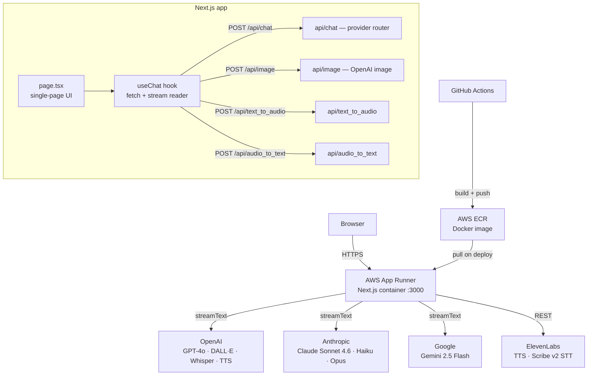

# AI Hub — Multi-Provider AI Chat, Image & Audio

A production-ready Next.js 16 + React 19 web app that unifies **chat, image generation, and audio (TTS/STT)** across four AI providers behind a single UI. Built as a portfolio project demonstrating AI backend engineering: provider abstraction, streaming, Docker, CI/CD, and AWS deployment.

**Live:** `https://www.diegoportillo.dev/ai_hub` *(deployment in progress)*

---

## What It Does

| Mode | What you can do |
|---|---|
| 💬 **Chat** | Streaming text conversation with OpenAI, Anthropic, or Google models |
| 🎨 **Image** | Generate images (DALL·E 2/3, GPT-image) or upload one for vision analysis |
| 🔊 **Audio** | Text-to-speech with OpenAI TTS or ElevenLabs; speech-to-text with Whisper or ElevenLabs Scribe v2 |

---

## Architecture



### Key design decisions

- **Single page, three modes** — `chat`, `image`, `audio` share state and the same input bar; mode switch is instant.
- **Provider abstraction via Vercel AI SDK** — `streamText` wraps OpenAI, Anthropic, and Google. Adding a new provider is one line in `api/chat/route.ts`.
- **Server-side conversation memory** — `Map<conversationId, Message[]>` in the Node process, capped and trimmed to 8 messages. Per-session UUID prevents cross-user memory leaks. Designed to be replaced with Redis for multi-instance deployments.
- **Image inputs** — always downsampled to `detail: "low"` server-side before forwarding to the model, keeping vision costs predictable.
- **Streaming** — the chat route returns `toTextStreamResponse()` (AI SDK v6); the client reads raw chunks via `ReadableStream.getReader()`.

---

## Provider & Model Matrix

| Provider | Chat | Image | TTS | STT | Models |
|---|:---:|:---:|:---:|:---:|---|
| **OpenAI** | ✅ | ✅ | ✅ | ✅ | GPT-4o, GPT-4o mini, GPT-4 Turbo; DALL·E 2/3; Whisper; TTS |
| **Anthropic** | ✅ | ❌ | ❌ | ❌ | Claude Sonnet 4.6, Haiku 4.5, Opus 4.6 |
| **Google** | ✅ | ❌ | ❌ | ❌ | Gemini 2.5 Flash, Gemini 2.5 Flash Lite |
| **ElevenLabs** | ❌ | ❌ | ✅ | ✅ | TTS (multilingual v2), Scribe v2 STT |

---

## Running Locally

### With Docker (recommended)

```bash
cp .env.example .env.local   # fill in your API keys
docker compose up --build    # http://localhost:3000
```

The Docker build runs tests before `next build` — broken code can't produce an image.

### With Node

```bash
cp .env.example .env.local
npm install
npm run dev    # http://localhost:3000
```

### Environment variables

Copy `.env.example` to `.env.local`. Required keys per provider:

```
OPENAI_API_KEY=
ANTHROPIC_API_KEY=
GOOGLE_GENERATIVE_AI_API_KEY=
ELEVENLABS_API_KEY=

# Optional model overrides
OPENAI_MODEL=gpt-4o
OPENAI_VISION_MODEL=gpt-4o-mini
OPENAI_IMAGE_MODEL=dall-e-2
ANTHROPIC_MODEL=claude-sonnet-4-6
ANTHROPIC_MAX_TOKENS=1024
GEMINI_MODEL=gemini-2.5-flash
```

Each route returns `500` if its provider key is missing — you only need keys for the providers you use.

---

## Tests

```bash
npm run test:run       # run once (used in Docker build and CI)
npm test               # watch mode
npm run test:coverage  # coverage report
```

| Test file | What it covers |
|---|---|
| `api/messages.test.ts` | `applyLowDetailToImages` — URL validation, type safety |
| `api/image-route.test.ts` | Route returns `500` (not crash) when API key missing |
| `hooks/chat-stream.test.ts` | Stream accumulation; regression for old `0:"..."` parser bug |
| `page/chat-display.test.tsx` | Full UI flow: mock API → user sends → AI response in DOM |

---

## CI/CD — GitHub Actions ✅

Three workflows under `.github/workflows/`:

| Workflow | Trigger | What it does |
|---|---|---|
| `ai_hub-ci.yml` | Push or PR touching `ai_hub/` | Lint + vitest; Docker smoke build on PRs to `main` |
| `ai_hub-deploy.yml` | Merge to `main` (or manual) | Build image → push to ECR → create/update App Runner service |
| `ai_hub-teardown.yml` | Manual only | Delete the App Runner service (stops billing) |

Auth uses **OIDC** — no long-lived AWS keys stored in GitHub secrets.

---

## AWS Deployment

### Infrastructure

```
GitHub Actions
  └── build Docker image → push to ECR (us-east-1)
        └── deploy to App Runner (auto-pulls from ECR)
```

**AWS App Runner** was chosen over ECS Fargate for simplicity: no cluster, no task definitions, no ALB to manage. Pay-per-use, scales to zero.

| Resource | Status |
|---|---|
| ECR repository (`ai-hub`, us-east-1) | ✅ provisioned |
| IAM role + OIDC provider for GitHub Actions | ✅ configured |
| GitHub secrets (AWS_ROLE_ARN + 4 API keys) | ✅ configured |
| App Runner service (verified live) | ⏳ pending first deploy |
| Custom domain `www.diegoportillo.dev/ai_hub` | ⏳ planned |

---

## Monitoring & Observability *(planned — due Nov 8)*

Structured JSON logging from `onFinish` per request:

```json
{
  "model": "gpt-4o",
  "provider": "openai",
  "tokens_in": 142,
  "tokens_out": 87,
  "latency_ms": 1243,
  "estimated_cost_usd": 0.00184
}
```

Planned CloudWatch alarms: CPU > 80%, 5xx > 5%, monthly cost > $50.

---

## Evaluation Harness *(planned — due Jul 12)*

Will run a golden dataset of ~30 prompts against the chat route, score with LLM-as-judge (GPT-4o mini), and post a pass/fail report as a GitHub Actions PR comment. See `PLAN.md` Block B.

---

## Cost Estimate

~100 chat requests/day on AWS App Runner:

| Item | Monthly cost |
|---|---|
| App Runner (0.25 vCPU, 0.5 GB) | ~$5–10 |
| ECR storage | ~$1 |
| **Infra subtotal** | **~$10** |
| OpenAI GPT-4o (100 req/day) | ~$7.50 |
| Anthropic Claude Sonnet (100 req/day) | ~$9 |
| Gemini 2.5 Flash (100 req/day) | ~$0.30 |
| ElevenLabs TTS | ~$9 |
| **Total (all providers active)** | **~$35/month** |

In practice only one provider is active per session — real cost will be lower.

---

## Project Structure

```
ai_hub/
├── app/
│   ├── api/
│   │   ├── chat/route.ts          # streaming chat — OpenAI, Anthropic, Google
│   │   ├── image/route.ts         # image generation — OpenAI
│   │   ├── text_to_audio/route.ts # TTS — OpenAI, ElevenLabs
│   │   ├── audio_to_text/route.ts # STT — Whisper, ElevenLabs Scribe v2
│   │   └── lib/                   # shared types, message conversion
│   ├── hooks/useChat.ts           # fetch + ReadableStream parser
│   ├── tests/                     # vitest — mirrors app/
│   ├── constants.ts               # model list, provider capabilities
│   ├── types.ts                   # shared TypeScript types
│   └── page.tsx                   # single-page UI
├── Dockerfile                     # multi-stage: deps → test → build → runner
├── docker-compose.yml             # local dev
└── .env.example                   # required keys documented
```
