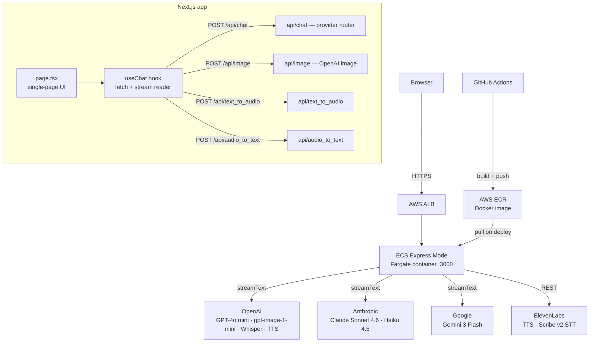

# AI Hub — Multi-Provider AI Chat, Image & Audio

A production-ready Next.js 16 + React 19 web app that unifies **chat, image generation, and audio (TTS/STT)** across four AI providers behind a single UI. Built as a portfolio project demonstrating AI backend engineering: provider abstraction, streaming, Docker, CI/CD, and AWS deployment.

**Problem:** switching between OpenAI, Anthropic, Google, and ElevenLabs playgrounds to compare models means juggling separate UIs, API shapes, and pricing pages. **Who it's for:** developers evaluating providers/models for a project, and anyone who wants one chat/image/audio interface instead of four. **Input:** text, images, or audio (mic or file upload). **Output:** streamed text, generated images, or synthesized/transcribed audio — routed to whichever provider and model you pick per request.

**Live:** [ai-2z4c4itsf-diegoportillos-projects.vercel.app](https://ai-2z4c4itsf-diegoportillos-projects.vercel.app/) *(Vercel Hobby tier — see [Cost Estimate](#cost-estimate) for why the live demo runs here instead of the AWS infra documented below)*

---

## What It Does

| Mode | What you can do |
|---|---|
| 💬 **Chat** | Streaming text conversation with OpenAI, Anthropic, or Google models |
| 🎨 **Image** | Generate images (OpenAI `gpt-image-1-mini`) or upload one for vision analysis |
| 🔊 **Audio** | Text-to-speech with OpenAI TTS or ElevenLabs; speech-to-text with Whisper or ElevenLabs Scribe v2 |

---

## Architecture



### Key design decisions

- **Single page, three modes** — `chat`, `image`, `audio` share state and the same input bar; mode switch is instant.
- **Provider abstraction via Vercel AI SDK** — `streamText` wraps OpenAI, Anthropic, and Google. Adding a new provider is one line in `api/chat/route.ts`.
- **Server-side conversation memory** — `Map<conversationId, Message[]>` in the Node process, capped and trimmed to 8 messages. Per-session UUID prevents cross-user memory leaks. Designed to be replaced with Redis for multi-instance deployments.
- **Rate limiting** — `proxy.ts` caps each IP at 20 requests/60s via an in-memory `Map`, returning `429` + `Retry-After: 60` over the limit. Same caveat as conversation memory: correct as long as the ECS service runs a single task (`desiredCount: 1`, true today); would need a shared store (Redis/DynamoDB) if scaled to multiple tasks.
- **Image inputs** — always downsampled to `detail: "low"` server-side before forwarding to the model, keeping vision costs predictable.
- **Streaming** — the chat route returns `toTextStreamResponse()` (AI SDK v6); the client reads raw chunks via `ReadableStream.getReader()`.

---

## Provider & Model Matrix

| Provider | Chat | Image | TTS | STT | Default models |
|---|:---:|:---:|:---:|:---:|---|
| **OpenAI** | ✅ | ✅ | ✅ | ✅ | `gpt-4o-mini` (chat + vision); `gpt-image-1-mini`; `tts-1`; `whisper-1` |
| **Anthropic** | ✅ | ❌ | ❌ | ❌ | `claude-sonnet-4-6` (also selectable: `claude-haiku-4-5`) |
| **Google** | ✅ | ❌ | ❌ | ❌ | `gemini-3-flash-preview` |
| **ElevenLabs** | ❌ | ❌ | ✅ | ✅ | `eleven_multilingual_v2` (TTS); Scribe v2 (STT) |

All model IDs are env-overridable (see [Environment variables](#environment-variables)) — the table above shows what ships if you don't override anything.

**On the public demo** (`PUBLIC_DEMO_MODE=true`), chat always forces a cheaper model per provider regardless of the selection above, to keep a publicly-reachable link's cost bounded: `gpt-5-nano` (OpenAI), `claude-haiku-5-5` (Anthropic), `gemini-3.5-flash-lite` (Google). Image and audio modes are not gated to a cheap model in demo mode — a deliberate scope trim (see `LOGBOOK.md`'s Oct 9 entry) — but all routes are still covered by the per-IP and global daily request caps in `proxy.ts`.

---

## Running Locally

### With Docker (recommended)

```bash
cp .env.example .env.local   # fill in your API keys
docker compose up --build    # http://localhost:3000
```

The Docker build runs tests before `next build` — broken code can't produce an image.

### With Node

```bash
cp .env.example .env.local
npm install
npm run dev    # http://localhost:3000
```

### Environment variables

Copy `.env.example` to `.env.local`. Required keys per provider:

```
OPENAI_API_KEY=
ANTHROPIC_API_KEY=
GOOGLE_GENERATIVE_AI_API_KEY=
ELEVENLABS_API_KEY=

# Optional model overrides — defaults shown
OPENAI_MODEL=gpt-4o-mini
OPENAI_VISION_MODEL=gpt-4o-mini
OPENAI_IMAGE_MODEL=gpt-image-1-mini
ANTHROPIC_MODEL=claude-sonnet-4-6
ANTHROPIC_MAX_TOKENS=1024
GEMINI_MODEL=gemini-3-flash-preview

# Public-demo safety — see Provider & Model Matrix above
PUBLIC_DEMO_MODE=        # "true" on a publicly-reachable deployment, unset for local dev
DEMO_DAILY_REQUEST_CAP=100
DEMO_DAILY_TOKEN_CAP=150000
```

Each route returns `500` if its provider key is missing — you only need keys for the providers you use.

---

## Tests

```bash
npm run test:run       # run once (used in Docker build and CI)
npm test               # watch mode
npm run test:coverage  # coverage report
```

| Test file | What it covers |
|---|---|
| `api/messages.test.ts` | `applyLowDetailToImages` — URL validation, type safety |
| `api/image-route.test.ts` | Route returns `500` (not crash) when API key missing |
| `hooks/chat-stream.test.ts` | Stream accumulation; regression for old `0:"..."` parser bug |
| `page/chat-display.test.tsx` | Full UI flow: mock API → user sends → AI response in DOM |

---

## CI/CD — GitHub Actions ✅

Four workflows under `.github/workflows/`:

| Workflow | Trigger | What it does |
|---|---|---|
| `ai_hub-ci.yml` | Push or PR touching `ai_hub/` | Lint + vitest; Docker smoke build on PRs to `main` |
| `ai_hub-deploy.yml` | Manual only | Build image → push to ECR → create/update ECS Express Mode service |
| `ai_hub-teardown.yml` | Manual only | Delete ECS service + cluster (stops Fargate billing) |
| `ai_hub-eval.yml` | Manual only | Run the golden-dataset eval suite against the deployed chat route; see [Evaluation Harness](#evaluation-harness) |

Auth uses **OIDC** — no long-lived AWS keys stored in GitHub secrets.

**Why `ai_hub-eval.yml` is manual-only, not wired to push/PR:** each run makes real paid calls to the provider(s) under test plus the LLM judge. Automatic wiring means every push/PR silently spends API budget with no way to throttle it. Keeping it a `workflow_dispatch` trades away automatic regression coverage on every change for deliberate control over when that spend happens — acceptable for a low-traffic portfolio project where a human is already reviewing every change anyway. Revisit if this project ever needs unattended CI gating.

**Why `ai_hub-deploy.yml` is manual-only too:** it was originally wired to auto-deploy on every merge to `main`, but that deploys to AWS ECS Express Mode, which bills for 24/7 Fargate + ALB regardless of traffic (~$53/mo) — an unattended merge should never be able to trigger real infra spend. The live demo link runs on Vercel instead (see [Cost Estimate](#cost-estimate)); this workflow stays available to run by hand whenever the actual AWS deployment is wanted.

---

## AWS Deployment

### Infrastructure

```
GitHub Actions
  └── build Docker image → push to ECR (us-east-1)
        └── deploy to ECS Express Mode (Fargate task, ALB auto-provisioned)
```

**AWS ECS Express Mode** handles infrastructure automatically: provisions a Fargate task, ALB, auto-scaling, and CloudWatch from a single deploy command. Replaces App Runner (stopped accepting new customers April 2026). Minimum sizing: 1 vCPU / 2 GB (app OOM'd at 0.5 GB on App Runner).

**Live service:** `https://ai-<ecs-id>.ecs.us-east-1.on.aws` — ECS Express Mode's auto-generated endpoint. The app is built with no base path (`NEXT_PUBLIC_BASE_PATH=`) and served at root.

> **Finding `<ecs-id>`:** the endpoint is generated by `aws-actions/amazon-ecs-deploy-express-service` each time the service is created (e.g. after a teardown). The most recent value is printed in the **"AI Hub — Deploy"** GitHub Actions run, in the "Print service endpoint" step / job summary.

| Resource | Status |
|---|---|
| ECR repository (`ai-hub`, us-east-1) | ✅ provisioned |
| IAM role + OIDC provider for GitHub Actions | ✅ configured |
| GitHub secrets (AWS_ROLE_ARN + 4 API keys) | ✅ configured |
| ECS Express Mode service + IAM roles | ✅ deployed |

---

## Monitoring & Observability

Structured JSON logging from `onFinish` per request, plus an in-memory metrics store surfaced at `GET /api/metrics` and the `/metrics` dashboard page (per-session request count, tokens, cost, TTFT, tokens/sec):

```json
{
  "requestId": "b2b1e...",
  "promptVersion": "v1",
  "model": "gpt-4o",
  "provider": "openai",
  "tokens_in": 142,
  "tokens_out": 87,
  "latency_ms": 1243,
  "estimated_cost_usd": 0.00184
}
```

The metrics store is process-local (resets on restart, not shared across ECS tasks) — deliberately kept simple rather than adding a DB dependency at this stage; see [Server-side conversation memory](#key-design-decisions) for the same tradeoff applied to chat history.

---

## Evaluation Harness

Runs a golden dataset of 31 prompts (`evals/golden_dataset.json`) against the chat route, scores each response with an LLM judge (`gpt-4.1-mini` — deliberately not one of the app's own answering models, to avoid self-judging bias), and reports pass/fail per prompt plus a diff against a committed baseline (`evals/baseline.json`).

- **Locally:** `npm run eval` (reads `.env.local`), then `npm run eval:report` for the markdown summary.
- **In CI:** the `ai_hub-eval.yml` workflow (see [CI/CD](#cicd--github-actions-)) runs the same suite and can post the report as a PR comment — triggered manually, not on every push, since each run costs real API money.
- **Provider coverage:** only `openai` is currently exercised in CI by default. Anthropic/Google web-search tool wiring in `route.ts` is untested.
- **Current results:** OpenAI baseline is **16/16 passing** (`evals/baseline.json`). A full run across all three chat providers scored 28/30 — the 2 failures traced to Google API quota exhaustion, not a code defect.

---

## Cost Estimate

~100 chat requests/day on AWS ECS Express Mode:

| Item | Monthly cost |
|---|---|
| Fargate (1 vCPU, 2 GB, 24/7) | ~$36 |
| ALB (shared across Express Mode services) | ~$16 |
| ECR storage | ~$1 |
| **Infra subtotal** | **~$53** |

> **Note:** ECS does not scale to zero. Stop the service when not demoing to pause Fargate charges.
| OpenAI GPT-4o (100 req/day) | ~$7.50 |
| Anthropic Claude Sonnet (100 req/day) | ~$9 |
| Gemini 2.5 Flash (100 req/day) | ~$0.30 |
| ElevenLabs TTS | ~$9 |
| **Total (all providers active)** | **~$35/month** |

In practice only one provider is active per session — real cost will be lower.

> **In practice, the live demo link runs on Vercel's free Hobby tier, not AWS ECS.** The AWS infra above (ECR, OIDC, ECS Express Mode) is built and deployable, but running it 24/7 just for a portfolio demo costs ~$53/month in idle infra for near-zero traffic — the same class of unnecessary always-on spend flagged elsewhere in this project. Vercel's free tier has no infra cost at all (hard-capped, not billed on overage) and only charges nothing at these traffic levels, so the public-demo link points there instead; AWS ECS deployment stays documented and ready as the production-shaped path, not the one actually serving the demo.

---

## Trade-offs

| Decision | Chose | Over | Why |
|---|---|---|---|
| Provider abstraction | Vercel AI SDK `streamText` | Hand-rolled per-provider clients | One interface for OpenAI/Anthropic/Google; adding a provider is a one-line change in `api/chat/route.ts` |
| Streaming | AI SDK's `toTextStreamResponse()` + manual `ReadableStream` reader | `useChat` from `ai/react` | Built before adopting the SDK's React hook; could be swapped in later to drop the manual parser (`app/hooks/useChat.ts`) |
| CI/CD gating | Manual-only (`workflow_dispatch`) for deploy + eval workflows | Auto-run on every push/PR | Deploy auto-triggers real AWS spend (~$53/mo Fargate+ALB) and eval auto-triggers real paid API calls — both need a human in the loop before spending money |
| Public demo hosting | Vercel free Hobby tier | AWS ECS Express Mode (the documented production path) | ECS bills 24/7 regardless of traffic; Vercel's free tier is hard-capped at $0 for this traffic level — see [Cost Estimate](#cost-estimate) |
| LLM provider strategy | Multi-provider (OpenAI/Anthropic/Google) | Single provider | Demonstrates provider abstraction directly — unlike `finance_rag_agent`, which stays single-provider so its eval comparisons (reranking, chunking) aren't confounded by also varying the model |

---

## Project Structure

```
ai_hub/
├── app/
│   ├── api/
│   │   ├── chat/route.ts          # streaming chat — OpenAI, Anthropic, Google
│   │   ├── image/route.ts         # image generation — OpenAI
│   │   ├── text_to_audio/route.ts # TTS — OpenAI, ElevenLabs
│   │   ├── audio_to_text/route.ts # STT — Whisper, ElevenLabs Scribe v2
│   │   └── lib/                   # shared types, message conversion
│   ├── hooks/useChat.ts           # fetch + ReadableStream parser
│   ├── tests/                     # vitest — mirrors app/
│   ├── constants.ts               # model list, provider capabilities
│   ├── types.ts                   # shared TypeScript types
│   └── page.tsx                   # single-page UI
├── Dockerfile                     # multi-stage: deps → test → build → runner
├── docker-compose.yml             # local dev
├── .env.example                   # required keys documented
└── MANUAL_TESTING.md              # manual QA checklist (mic/audio flows vitest can't cover)
```
