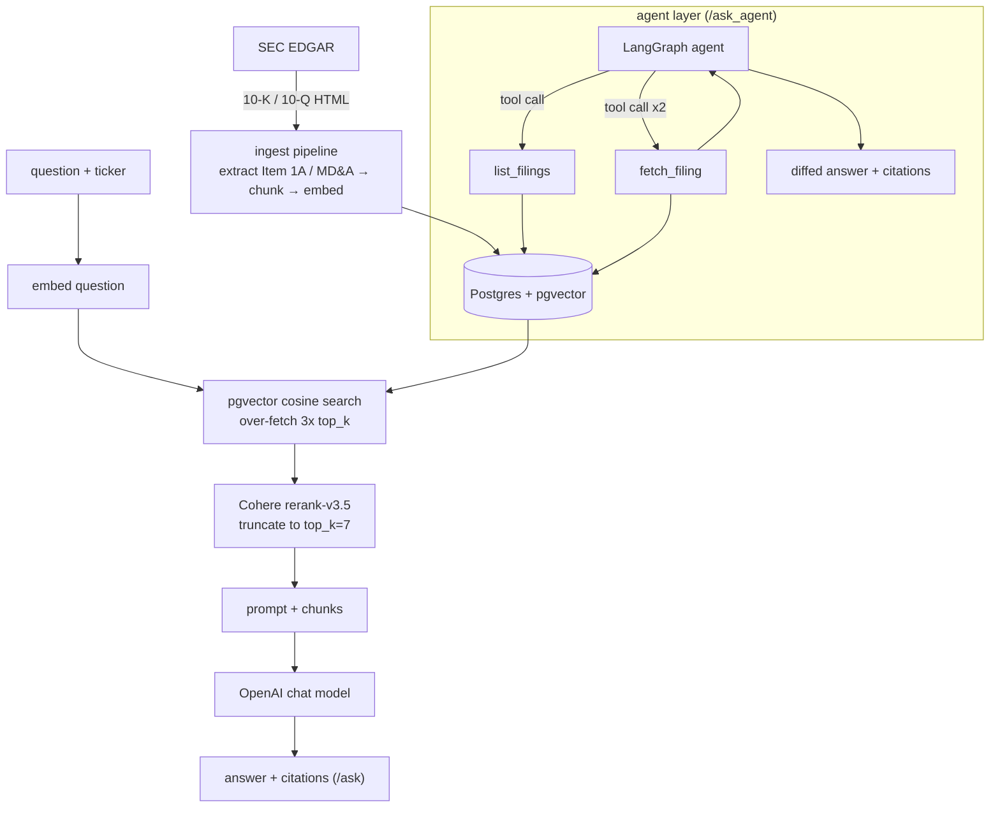

# Finance RAG Agent

A RAG + agent system that answers natural-language questions about public companies' SEC filings (10-K/10-Q), with citations back to the source text and an agent layer that can compare filings across periods. Built as a portfolio project demonstrating a production RAG pipeline: retrieval, reranking, grounded generation, an eval harness, and agentic tool use — not just a prompt wrapper around an LLM.

**Problem:** reading a 10-K/10-Q to answer a specific question (a number, a risk factor, a change between periods) means manually searching a 50+ page filing. **Who it's for:** anyone who wants to query a company's filings directly instead of reading them. **Input:** a natural-language question + ticker (AMZN, NVDA, or KO — the pilot companies). **Output:** a grounded answer with citations to the exact filing excerpts used, or an explicit refusal when the filings don't contain the answer.

**Live:** [finance-rag-agent-i0ca.onrender.com](https://finance-rag-agent-i0ca.onrender.com) *(Render free tier + Neon free Postgres/pgvector — no AWS, no always-on cost)*. Try it: `POST /ask` or `POST /ask_agent` with `{"question": "...", "ticker": "AMZN"}`. First request after idle may be slow (free-tier cold start).

---

## Why This Project

**Domain: Finance**, picked over e-commerce (the original choice) and healthcare (the runner-up) on two axes:
- **Demand:** highest of any domain in the [AI engineering field guide](https://github.com/alexeygrigorev/ai-engineering-field-guide)'s use-case data — 2,321 mentions (9.5% of use cases), vs. 1,783 for healthcare and 226 for retail/e-commerce.
- **Data-access risk:** lowest of the three once scoped correctly — SEC EDGAR filings are public record with a free, keyless API, vs. e-commerce's proprietary per-retailer catalogs or healthcare's HIPAA/PHI exposure on anything clinical.

**Evidence from the job market** — five real job descriptions and three engineering blogs/case studies were reviewed before picking the problem:

| Company | Job description | What it signals |
|---|---|---|
| Capital One | [Senior Lead AI Engineer, GenAI Platform Services](https://builtin.com/job/senior-lead-ai-engineer-gen-ai-platform-services/9420327) | Platform-level GenAI engineering, not research — building the infra other teams build on. |
| Wells Fargo | [Lead Specialty AI Java Software Engineer, Electronic Trading](https://builtin.com/job/lead-specialty-ai-java-software-engineer-electronic-trading/9879596) | AI applied directly inside a trading workflow, not a bolt-on chatbot. |
| BlackRock | [Rust AI Engineer, Director](https://builtin.com/job/rust-ai-engineer-director/9629914) | Asset-manager-side AI engineering — performance-sensitive, not just prototyping. |
| Bloomberg | [Senior GenAI Platform Engineer](https://bloomberg.avature.net/careers/JobDetail/Senior-GenAI-Platform-Engineer-Artificial-Intelligence/18586) | "Build better search, discovery, and workflow solutions" — Bloomberg's core business *is* financial-document retrieval. Requires MCP/A2A/LangGraph/LlamaIndex/Pydantic AI — the same tool-use stack this project uses. |
| Morgan Stanley | [AI Engineer](https://morganstanley.eightfold.ai/careers/job/549797703474) | Building/deploying AI agents at scale; LangChain/LangGraph/CrewAI/AutoGen required. |

The most concrete validation is Morgan Stanley's own production system: the [Morgan Stanley × OpenAI case study](https://openai.com/index/morgan-stanley/) describes "AI @ Morgan Stanley Assistant," which gives financial advisors RAG access to ~100,000 internal research reports with 98% advisor-team adoption, rolled out via evaluation-driven development (human graders scoring summarization accuracy/coherence before shipping) — the same eval-first approach this project follows.

**Prior art studied** — two actively-maintained reference repos for this exact domain, inspected directly (READMEs, file tree, real test code):
- [SEC Insights](https://github.com/run-llama/sec-insights) — RAG over 10-K/10-Q PDFs with streamed, cited answers. Weak on proof: one test file total, no eval set; the README itself admits "room for improvement in RAG performance."
- [Invoice Extract and Reconcile](https://github.com/run-llama/template-workflow-extract-reconcile-invoice) — invoice-vs-contract reconciliation. Better tested (3 real pytest tests against a fake server + a real sample PDF, two of them genuine regression tests), but none test whether the *extraction or match is actually correct* — only that the plumbing/schema holds.

Neither reference has an eval harness measuring output correctness — only plumbing tests or ops monitoring. The eval harness in this project (Ragas: retrieval@k, faithfulness, answer relevance — see below) directly closes that gap.

**Pilot companies:**

| Company | Ticker | Why |
|---|---|---|
| Amazon | AMZN | Supply chain/logistics risk profile |
| NVIDIA | NVDA | AI/regulatory/export-control risk profile |
| Coca-Cola | KO | Commodity/international-currency risk profile |

Chosen for varied risk-factor profiles so period-over-period risk-factor diffs are substantive rather than boilerplate. All three file standard 10-K/10-Q (no 20-F handling needed).

---

## Architecture



The agent layer (`app/agent.py`, LangGraph) wraps the same filings in two tools — `list_filings` and `fetch_filing` — so it can pull two periods' risk-factor text and diff them, for questions a single RAG query can't answer (e.g. "how did Amazon's risk factors change between Q1 and Q2 2026?"). Middleware enforces correctness and cost bounds: `DedupeFetchFilingMiddleware` blocks refetching a period already pulled in the same run, `ToolCallLimitMiddleware(run_limit=4)` caps tool calls per question, and `ToolCallLoggingMiddleware` logs every call (see the [trace walkthrough](#agent-tool-call-trace-walkthrough) below).

Both the RAG pipeline and the agent loop are instrumented with **LangSmith** (LangChain-native, wired in from the start): every retrieval, rerank, and LLM call is a span in a full request trace, with per-span latency and token counts — the same multi-step tool-calling sequence in the trace walkthrough below is visible there with full nested detail, not just the summarized log line.

---

## Models & Providers Matrix

| Layer | Provider | Model | Used for | Env override |
|---|---|---|---|---|
| Embeddings | OpenAI | `text-embedding-3-small` | Chunk + query embeddings for pgvector cosine search | `EMBEDDING_MODEL` |
| Chat / generation | OpenAI | `gpt-5-mini` (default) | RAG answer synthesis (`/ask`) and agent reasoning (`/ask_agent`) | `OPENAI_CHAT_MODEL` |
| Reranking | Cohere | `rerank-v3.5` | Re-scores the over-fetched candidate pool before truncating to `top_k` | `RERANK_MODEL` |
| Orchestration | LangChain + LangGraph | — | Agent tool-calling loop; middleware for dedup/logging/call-limits | — |
| Tracing | LangSmith | — | Full RAG + agent pipeline observability | `LANGSMITH_*` |

One provider per layer, deliberately — unlike `ai_hub` (which demonstrates multi-provider chat), this project keeps one primary LLM vendor so eval comparisons (reranking, chunking) aren't confounded by also varying the model; see [Trade-offs](#trade-offs).

---

## Running Locally

```bash
cd finance_rag_agent
python -m venv .venv
source .venv/Scripts/activate      # Git Bash on Windows; use .venv/bin/activate on macOS/Linux
pip install -r requirements.txt

cp .env.example .env               # fill in OPENAI_API_KEY, COHERE_API_KEY, SEC_EDGAR_USER_AGENT, etc.
docker compose up -d               # local Postgres + pgvector on :5432
psql "$DATABASE_URL" -f db/schema.sql

python -m ingest.run_ingest        # pulls AMZN/NVDA/KO filings from EDGAR, chunks, embeds, stores
uvicorn app.main:app --reload      # http://localhost:8000
```

Then query it:

```bash
curl -X POST localhost:8000/ask -H "Content-Type: application/json" \
  -d '{"question": "What are Amazon'"'"'s main supply chain risks?", "ticker": "AMZN", "top_k": 5}'

curl -X POST localhost:8000/ask_agent -H "Content-Type: application/json" \
  -d '{"question": "How did NVIDIA'"'"'s risk factors change between FY2025 and FY2026?", "ticker": "NVDA"}'
```

Required env vars: `OPENAI_API_KEY`, `COHERE_API_KEY`, `DATABASE_URL`, `SEC_EDGAR_USER_AGENT` (SEC requires an identifying string on every request). Optional: `OPENAI_CHAT_MODEL`, `EMBEDDING_MODEL`, `RERANK_MODEL`, `LANGSMITH_*` (tracing) — see `.env.example` for the full list.

---

## Retrieval Quality

Both changes below were measured the same way: run the full pipeline against `eval/golden_dataset.json` (29 questions across AMZN/NVDA/KO, including 3 designed to trigger a refusal), score retrieval and answer quality with [Ragas](https://docs.ragas.io/) (`context_precision`, `context_recall`, `faithfulness`, `answer_relevancy`), and diff against the prior baseline with everything else held constant.

### Reranking

Plain vector search (cosine similarity over `text-embedding-3-small` embeddings) finds chunks that are *topically* similar to a question, not necessarily chunks that *answer* it. Added a two-stage retrieval step: over-fetch a candidate pool from pgvector (3× the final `top_k`), then rerank that pool with Cohere's `rerank-v3.5` before truncating to the real `top_k=7` (`app/retrieval.py`).

| Metric | Before (vector search only) | After (+ Cohere rerank) | Δ |
|---|---|---|---|
| context_precision | 0.642 | 0.772 | **+0.130** |
| context_recall | 0.768 | 0.899 | **+0.130** |
| faithfulness | 0.851 | 0.920 | +0.069 |
| answer_relevancy | 0.575 | 0.632 | +0.057 |

Refusal checks: 3/3 passed. Agent eval cases: 4/4 passed.

**Verdict: clear win, kept in production.** A two-stage retrieve-then-rerank pipeline measurably finds better-targeted chunks than vector search alone, at a cost of one Cohere API call per question. Chose Cohere's hosted rerank over a locally-hosted cross-encoder specifically because this app runs on a pay-per-use budget — a local model would need a permanently larger (and therefore permanently billed) container, while Cohere only costs money on an actual request.

### Chunking strategy comparison

The production pipeline splits each filing into its SEC "Item" sections (Risk Factors, MD&A) via regex, then chunks each section with `RecursiveCharacterTextSplitter` (1000 chars, 150 overlap). As a comparison, built a second pipeline (`eval/chunking_experiment.py`) that re-fetches the same filings from EDGAR and chunks them with LangChain's `SemanticChunker` instead — which splits at embedding-detected meaning boundaries rather than a fixed character count — then runs the identical retrieve → rerank → generate → score pipeline against it.

| Metric | Current (RecursiveCharacterTextSplitter) | Semantic (`SemanticChunker`) | Δ |
|---|---|---|---|
| context_precision | 0.772 | 0.803 | +0.031 |
| context_recall | 0.899 | 0.887 | −0.012 |
| faithfulness | 0.920 | 0.938 | +0.018 |
| answer_relevancy | 0.632 | 0.638 | +0.006 |

**Verdict: a wash, kept the simpler strategy.** Semantic chunking edges ahead on three metrics and slightly behind on one — small enough deltas to plausibly be noise, especially next to reranking's unambiguous +0.13 jump on both precision and recall. `SemanticChunker` also costs extra OpenAI embedding calls (once per sentence-group, to find its breakpoints, on top of the usual per-chunk embedding) for no measurable retrieval benefit here. Kept `RecursiveCharacterTextSplitter` in production — simpler, cheaper, and just as good on this filing set.

---

## Running the Eval Harness

```bash
python -m eval.run_eval              # full suite: refusal checks, agent eval, RAG scoring (current chunking + reranking)
python -m eval.chunking_experiment   # semantic-chunking comparison only (re-fetches filings from EDGAR, no DB writes)
```

Both write a timestamped results folder under `eval/results/` with the raw Ragas scores. The eval harness is also what caught the two real bugs behind the numbers above: a retrieval bug that was undercounting relevant chunks at `top_k=5` (fixed by bumping to `top_k=7`, pre-dating reranking), and a Cohere Trial-key rate limit (10 calls/minute) that crashed the scoring loop the first time it ran post-reranking — fixed by pacing the loop with `time.sleep(7)` between requests.

---

## Full Eval Results: Refusal + Agent Behavior

The RAG retrieval metrics are above (Reranking/Chunking tables); this covers the other two eval categories the harness runs — refusal correctness and agent tool-use correctness — previously split across `eval/results/*/refusal_checks.json` and `agent_checks.json`. Latest run: `eval/results/20261007_104740/`.

**Refusal checks (3/3 passed)** — the model must decline to answer when the filings don't contain the requested figure, not fabricate one:

| Question | Ticker | Passed | Behavior |
|---|---|---|---|
| What was Amazon's net sales in fiscal year 2022? | AMZN | ✅ | Refused the exact figure; offered to compute an estimate from numbers actually in context instead of inventing one |
| According to Coca-Cola's FY2025 10-K, what were total net operating revenues? | KO | ✅ | Refused — the figure isn't in the retrieved context — and offered alternatives instead of guessing |
| What is NVIDIA's current stock price? | NVDA | ✅ | Refused — out of scope for filings data — and explained why |

**Agent eval cases (4/4 passed)** — cross-period risk-factor comparisons requiring `list_filings` + `fetch_filing` tool use:

| Question | Ticker | Passed | Tool calls | Behavior |
|---|---|---|---|---|
| How did Amazon's risk factors change between Q1 2026 and Q2 2026 10-Q filings? | AMZN | ✅ | `list_filings`×1, `fetch_filing`×2 | Found one real addition (foreign-exchange note disclosure), correctly called the rest unchanged |
| How did NVIDIA's risk factors change between FY2025 and FY2026 10-K filings? | NVDA | ✅ | `list_filings`×1, `fetch_filing`×2 | Found five substantive changes (export-control developments, new partnership disclosures, revenue-mix/headcount updates) with citations |
| How did Coca-Cola's risk factors change between Q2 2026 and Q3 2026 10-Q filings? | KO | ✅ | `list_filings`×1, `fetch_filing`×2 | Correctly identified the risk factors as substantively unchanged (boilerplate cross-reference in both periods) |
| How did Tesla's risk factors change between its two most recent 10-K filings? | TSLA | ✅ | `list_filings`×1 | TSLA isn't a pilot company — `list_filings` returned nothing, and the agent reported that directly instead of retrying or guessing |

---

## Agent Tool-Call Trace Walkthrough

One real `/ask_agent` call, captured end-to-end (question: *"How did Amazon's risk factors change between the Q1 2026 and Q2 2026 10-Q filings?"*, ticker `AMZN`) via `ToolCallLoggingMiddleware`'s per-call logging:

```
[tool_call] tool=list_filings args={'ticker': 'AMZN', 'form_type': '10-Q'} latency_ms=3283.0 result_chars=625
[tool_call] tool=fetch_filing args={'ticker': 'AMZN', 'form_type': '10-Q', 'period': 'Q2 2026'} latency_ms=897.7 result_chars=66277
[tool_call] tool=fetch_filing args={'ticker': 'AMZN', 'form_type': '10-Q', 'period': 'Q1 2026'} latency_ms=930.9 result_chars=66296
```

1. **`list_filings(ticker=AMZN, form_type=10-Q)`** — the agent first asks what periods exist at all, rather than guessing period names; returns the two most recent 10-Qs (Q1 2026, Q2 2026).
2. **`fetch_filing(..., period=Q2 2026)`** then **`fetch_filing(..., period=Q1 2026)`** — pulls the full Item 1A text for each period exactly once each (`DedupeFetchFilingMiddleware` blocks a third, redundant fetch of either period if the model tries).
3. No further tool calls — `ToolCallLimitMiddleware(run_limit=4)` caps the run at 4 tool calls, but the agent only needed 3 here before it had enough to answer.

Final answer (grounded in the two fetched texts, not in the model's own knowledge):

> I compared Amazon's Item 1A "Risk Factors" text in the Q1 2026 and Q2 2026 10-Q filings section-by-section. The risk factor disclosures are substantively unchanged between the two filings except for one explicit addition in Q2 2026: Q2 expands the foreign-exchange disclosure to state that Amazon issues notes in foreign currencies and that foreign-denominated note balances and payments are exposed to translation risk. No other new or removed risk factor headings, named events, transactions, or materially different risk descriptions were found in the texts provided.

Citations returned alongside it:
- Amazon (AMZN) 10-Q Q2 2026 — *We Have Foreign Exchange Risk* — [source](https://www.sec.gov/Archives/edgar/data/1018724/000101872426000026/amzn-20260630.htm)
- Amazon (AMZN) 10-Q Q1 2026 — *We Have Foreign Exchange Risk* — [source](https://www.sec.gov/Archives/edgar/data/1018724/000101872426000014/amzn-20260331.htm)

---

## Cost Estimate

Per-request cost, current defaults (`gpt-5-mini`, `text-embedding-3-small`, `rerank-v3.5`):

| Request | What runs | Approx. cost |
|---|---|---|
| `POST /ask` | 1 query embedding + 1 Cohere rerank (≤100 docs) + 1 chat completion (~2.5K input / ~400 output tokens) | **~$0.003–0.004** |
| `POST /ask_agent` | `list_filings` + 2×`fetch_filing` (large filing text re-sent as context across 3–4 LLM turns, ~35–50K cumulative input tokens) + final synthesis | **~$0.01–0.02** |
| One-time ingest (all 12 pilot filings, 1,344 chunks) | Chunk embeddings only (`text-embedding-3-small`) | **< $0.01 total** |

Rates used: OpenAI `gpt-5-mini` $0.25 / $2.00 per 1M input/output tokens; `text-embedding-3-small` $0.02 per 1M tokens; Cohere rerank $2.00 per 1,000 searches (1 search ≤ 100 docs). Verify current rates on each provider's pricing page before budgeting — these move.

**Hosting: $0/month.** Render's free web-service tier (750 instance-hrs/month, sleeps after ~15 min idle) + Neon's free Postgres/pgvector tier (1 GB storage, pgvector preinstalled). No AWS, no always-on infra — see [Trade-offs](#trade-offs) for why this skipped the ECS path `ai_hub` uses.

---

## Trade-offs

| Decision | Chose | Over | Why |
|---|---|---|---|
| Application framework | FastAPI | Flask, Django | Async + Pydantic is the AI-serving standard; `ai_hub` already covers the React/Next.js half of the portfolio |
| Orchestration | LangChain + LangGraph | LlamaIndex, CrewAI | LangChain appears in 34.3% of job listings in the field guide's data; LangGraph is its agent layer, not a competing framework |
| Vector store | Postgres + pgvector | Pinecone, Weaviate | One DB for relational + vector data (agent tools need SQL joins anyway); cheapest option below ~10M vectors |
| Reranking | Cohere hosted `rerank-v3.5` | Local cross-encoder | Pay-per-use fits a portfolio project's traffic; a local model needs a permanently-billed container regardless of traffic (see [Retrieval Quality](#retrieval-quality)) |
| Chunking | `RecursiveCharacterTextSplitter` | `SemanticChunker` | Measured a wash in Ragas scores (see [Retrieval Quality](#retrieval-quality)) at the cost of extra embedding calls — kept the simpler, cheaper option |
| Hosting | Render + Neon (free tier) | AWS ECS (the `ai_hub` path) | Zero idle cost; the agent's multi-step tool-calling loop also doesn't fit cleanly inside a serverless-function timeout model |
| LLM provider | One primary provider (OpenAI) | Multi-provider | `ai_hub` already demonstrates provider abstraction; this project stays "boring" on the LLM layer so eval comparisons (reranking, chunking) aren't confounded by also varying the model |

---

## Status

- [x] Baseline RAG endpoint with citations and refusal behavior
- [x] LangSmith tracing across the RAG and agent pipelines
- [x] Ragas eval harness (retrieval@k, faithfulness, answer relevance)
- [x] Agent layer (cross-period filing comparison, 2+ tools, tool-call logging)
- [x] Reranking + chunking-strategy comparison (this section)
- [x] Live deployment (Render + Neon, free tier — see Live link above)
- [x] Full eval results table covering refusal + agent behavior in one place (see Full Eval Results section)
- [x] Walkthrough of one full agent tool-call trace (see Agent Tool-Call Trace Walkthrough section)
